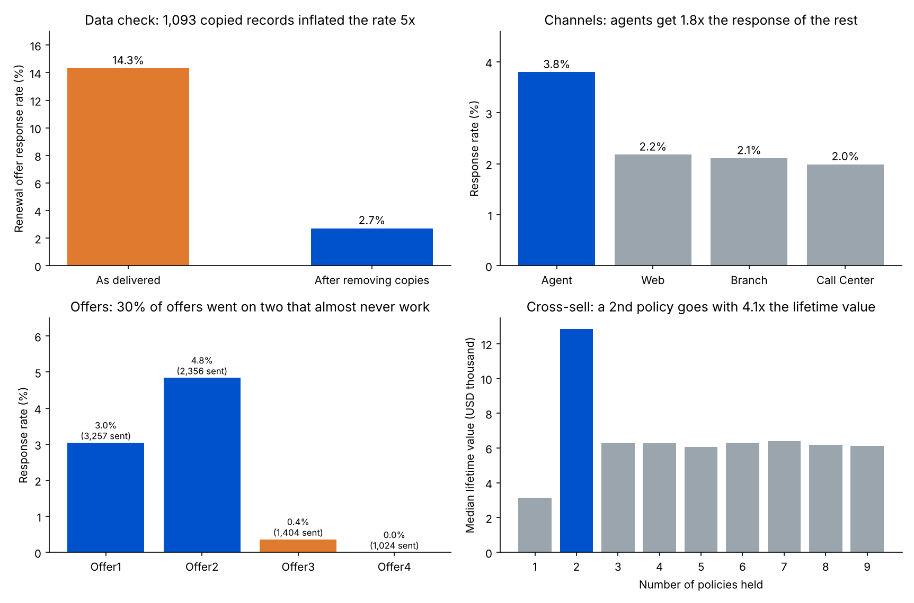

# Insurance Renewal & Growth Playbook: Channels, Offers and Who to Call First

A growth and sales-operations analysis for an insurance broker: which sales channel and renewal offer get customers to respond, which customers are worth the most, and how a response-propensity model can decide who gets called first and with which offer. It starts with a data check that changes the headline number.

**Data:** IBM's public *Marketing Customer Value Analysis* sample: **9,134** US auto insurance customer records (2011), each with state, coverage, policy type, income, employment status, monthly premium, customer lifetime value (CLV), the renewal offer they got (Offer1–4), the sales channel (Agent, Branch, Call Center, Web) and whether they responded.



## Key findings

| Area | Finding | Action |
|---|---|---|
| Data check | **1,093** records (**12%**) are copies of other records: different customer IDs, often in different states, that repeat another record's lifetime value and income to the cent. **99.7%** of the copies are responders, so the delivered response rate of **14.3%** is inflated about 5x. After keeping one record per cluster, **8,041** customers remain and the true response rate is **2.7%**. | Deduplicate before any KPI; a 14% vs 3% response rate changes every campaign plan |
| Channels | Agents get a **3.8%** response, **1.8x** the rate of the other channels combined (Web 2.2%, Branch 2.1%, Call Center 2.0%). Agents handle **36%** of customers but win **51%** of responders. | Copy what agents do (script, follow-up) into calls, email and web |
| Offers | Offer2 gets **4.8%**, Offer1 **3.0%**, but Offer3 (**0.4%**) and Offer4 (**0%**) almost never work, and they went to **30%** of customers. If those **2,428** customers had responded at Offer2's rate, the overall rate would rise from **2.7%** to about **4.1%** (an estimate to A/B test, not a result). | Stop sending Offer3 and Offer4; test Offer2 in their place |
| Segments | Retired customers respond at **30%** (112 customers), against **2.5%** for employed and **1.5%** for unemployed customers. | Prioritise segments with high response in the call list |
| Value | The top **20%** of customers hold **46%** of total lifetime value. Customers with 2 policies have a median CLV of **USD 12.8K**, **4.1x** single-policy customers (USD 3.1K), and **35%** of customers hold only one policy. | Cross-sell a second policy to single-policy customers |
| Who to call first | A gradient-boosting model (5-fold cross-validated, AUC **0.74**) puts **50%** of responders in the top **20%** of customers, **2.5x** better than calling at random. | Rank the call list by propensity |

## Method

**Near-duplicate check.** Records are grouped by lifetime value and income. Both are continuous values given to many decimal places, so identical pairs across different customer IDs are copies. One record per group is kept for every analysis after the check.

**Response rate** = customers who responded ÷ customers who received an offer, by channel, offer and segment.

**Offer what-if.** Extra responders = (customers on Offer3 or Offer4 × Offer2's response rate) − responders those customers actually gave. This assumes the customers would respond like Offer2's customers, which an A/B test would need to confirm.

**Value concentration.** Customers are sorted by CLV; top-20% share = their CLV ÷ total CLV. CLV is the value given in the dataset.

**Propensity model.** `HistGradientBoostingClassifier` on 20 customer, policy, offer and channel fields, scored with 5-fold stratified cross-validation so each customer is scored by a model that never saw them. Capture at 20% = share of all responders among the top 20% of customers by score; lift = top-20% response rate ÷ overall response rate.

## Playbook

1. **Clean first:** deduplicate customer records before reporting any campaign KPI.
2. **Retire weak offers:** stop Offer3 and Offer4, and A/B test Offer2 against Offer1 on the customers who used to get them.
3. **Spread the agent advantage:** record what agents say and when they follow up, and build it into call, email and web scripts.
4. **Call in order:** work the list by propensity score, starting with high-response segments.
5. **Cross-sell:** offer a second policy to single-policy customers, starting with those with the highest propensity.
6. **Measure:** keep a random holdout in every campaign; track response rate, cost per response and second-policy rate.

## Outputs

- `results/renewal_playbook.xlsx`: Data checks, By channel, By offer, By employment, Offer x channel, Playbook and a Call list ranked by propensity
- `results/results.json`: every number in this README
- `results/summary.png`: the four charts above

## Limitations

- IBM's sample dataset is a teaching dataset and is likely partly simulated (for example, Offer4 gets exactly zero responses, and CLV jumps at exactly 2 policies). The patterns show how to analyse a renewal book; they should be checked on a real broker's data before acting.
- Offers and channels were not assigned at random, so their differences are associations, not proven causes.
- The offer what-if is an estimate, not a measured result.

## Run it

```bash
pip install pandas numpy scikit-learn matplotlib openpyxl
python get_data.py       # only if data/ is empty: downloads the dataset into data/
python run_analysis.py   # writes results/results.json and renewal_playbook.xlsx
python make_charts.py    # writes results/summary.png
```

## Data source

IBM Watson Analytics, *Marketing Customer Value Analysis* sample dataset. `get_data.py` downloads it from a public GitHub mirror.
